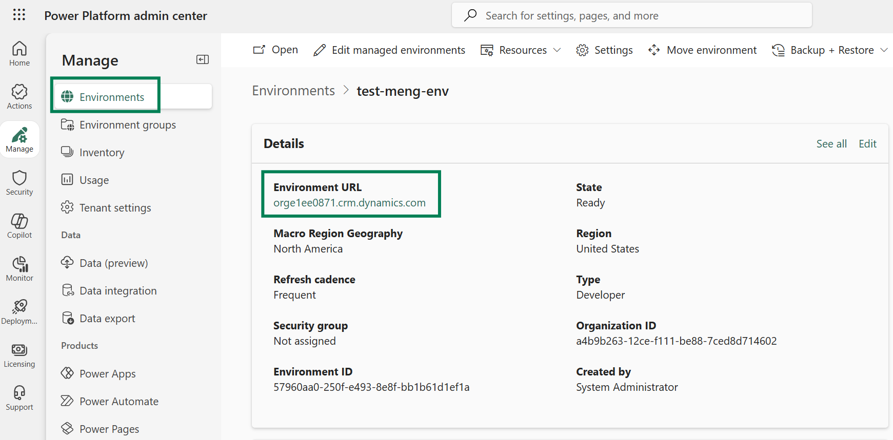
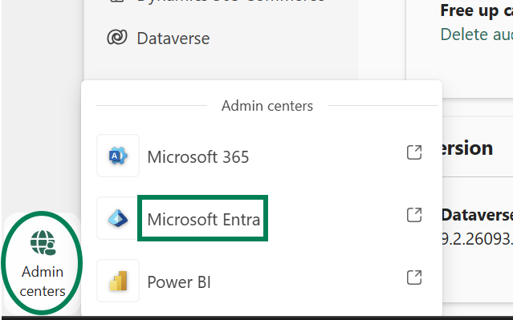
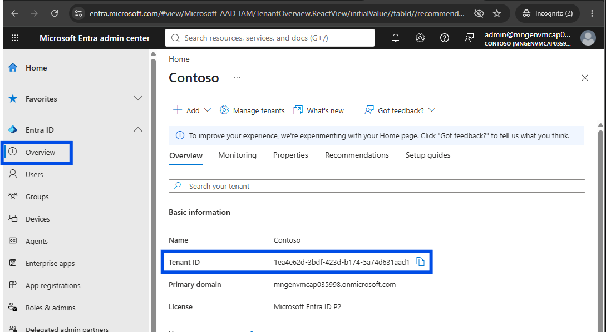
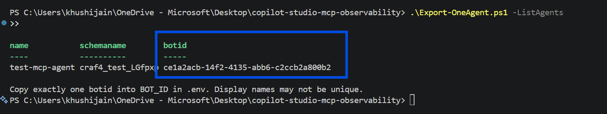
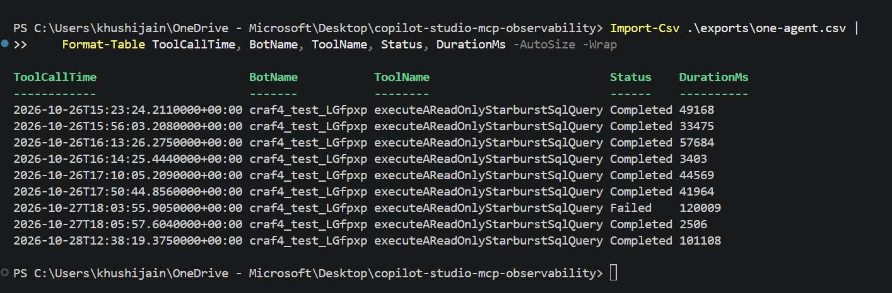
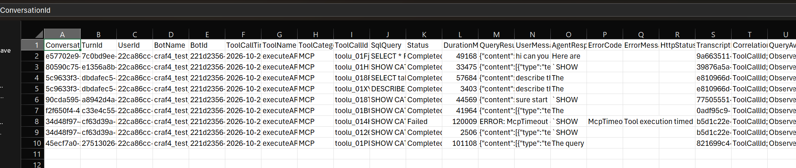
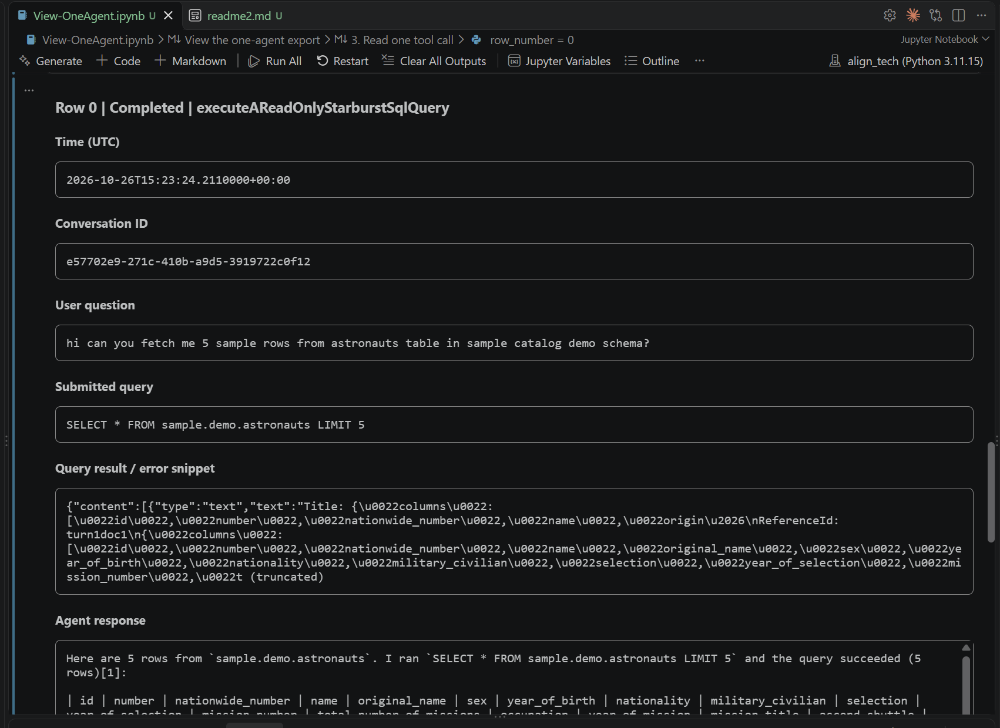
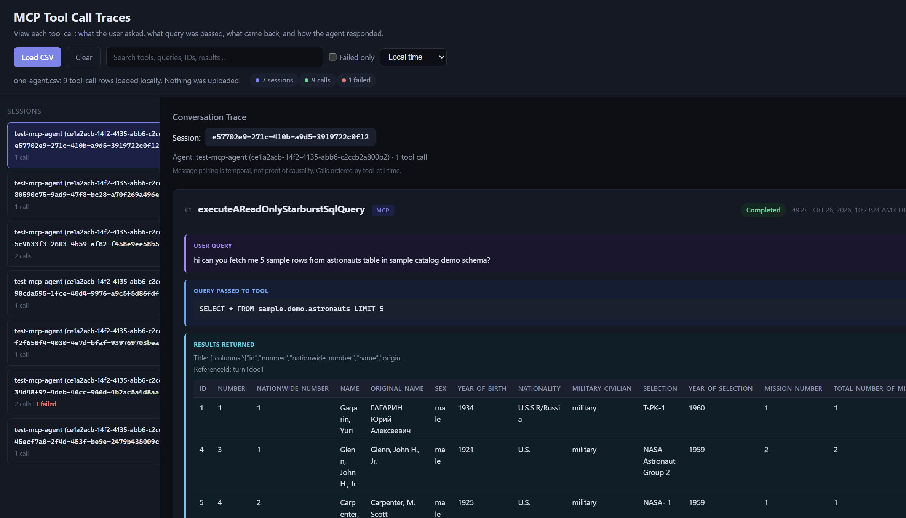
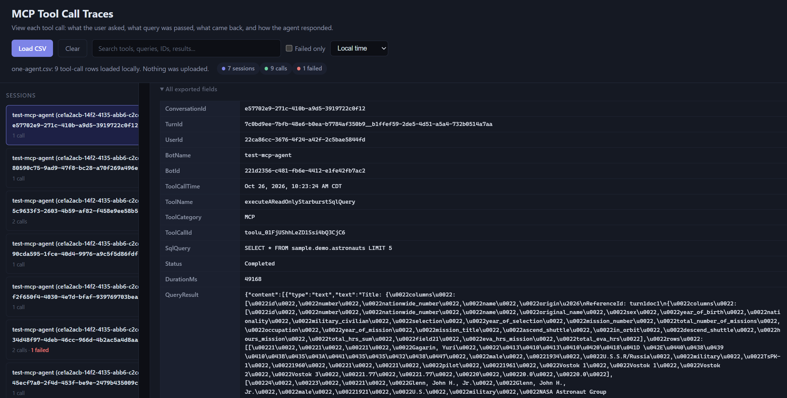

# Monitoring MCP Tool Calls in a Copilot Studio Agent

<details>
<summary><strong>Purpose — trace MCP calls for ONE Copilot Studio agent</strong></summary>

Use this branch to investigate **one Copilot Studio agent** without deploying a service.
You supply the environment URL and one agent ID, sign in with Azure CLI, and run a local
PowerShell helper to turn available Dataverse transcripts into a table connecting
**conversation -> MCP tool call -> submitted query -> result/error**. The resulting CSV
helps you inspect what happened in a conversation, including available prompts, replies,
durations and error evidence. This is an on-demand troubleshooting tool, not a scheduled
collector, and it cannot recover details that were never recorded or exposed by the source.

You are on **`script-template`**. This branch is a local, interactive PowerShell tool.
It does not deploy Azure resources or run queries against your downstream database.
For scheduled private centralized dumps, switch to **`enterprise-automation`** and read its different README.

### What the output table looks like

The CSV has **22 columns**, described below. Each row represents an observed completed or failed
tool event for your selected agent, not an entire conversation. Multiple tools in one conversation
produce multiple rows. Consent suspensions are skipped; starts without a completion produce warnings,
not output rows. The extractor reads tool traces; `ToolCategory` is source evidence, not an enforced
MCP-only filter.

This compact preview shows selected columns from **fabricated example rows**; it is not client data:

| BotName | ConversationId | ToolCallId | ToolName | SqlQuery | Status | DurationMs | ErrorCode | HttpStatusCode |
|---|---|---|---|---|---|---|---|---|
| sample_agent | sample-conversation-01 | call-1 | sample_mcp | SELECT COUNT(*) FROM sample | Completed | 300 | *(blank)* | *(blank)* |
| sample_agent | sample-conversation-01 | call-2 | sample_mcp | SELECT COUNT(*) FROM sample | Failed | 1200 | ConnectorError | *(blank)* |

A failed call does not establish an HTTP 500. HTTP status is populated only if the source event
explicitly provides it. Identifiers, query text and other fields may be unavailable in real transcripts.

### Output data dictionary

Types describe the logical values; CSV stores their text representations, with null/missing values
shown as empty cells. Example values below are synthetic.

| Column | Type / example | Meaning for investigating this agent's MCP calls |
|---|---|---|
| `ConversationId` | Text: `sample-conversation-01` | Identifies the conversation containing the tool event. Uses an activity's conversation ID when present; otherwise removes the known bot-ID suffix from the transcript name. |
| `TurnId` | Text: `user-msg-1__agent-msg-1` | Combines the selected user-message and reply IDs. Groups calls paired to the same messages; this is a derived value, not a platform-issued turn ID. Missing message IDs leave empty components. |
| `UserId` | Text: user object ID, or blank | Source user's Entra object ID from the selected user message, when recorded. Potentially personal data; not guaranteed for every channel. |
| `BotName` | Text: `sample_agent` | Agent name recorded in transcript metadata (`BotName`); may be a schema-style name rather than the friendly display name. |
| `BotId` | GUID text: `aaaaaaaa-aaaa-aaaa-aaaa-aaaaaaaaaaaa` | Agent ID preserved from transcript metadata. It may differ from the Dataverse Agent row ID; use `AgentId` to verify the selected agent. |
| `ToolCallTime` | ISO 8601 UTC text: `2026-01-02T10:00:00.0000000+00:00` | Time of the matched tool start. If the start is missing, uses the completion/failure event time instead. |
| `ToolName` | Text: `sample_mcp` | Tool display name from the completion/failure event. This may identify a connector/tool grouping, not necessarily a downstream server operation. |
| `ToolCategory` | Text: `MCP`, or blank | Source-reported tool category. Use it to inspect whether the observed tool is categorized as MCP; the exporter does not invent a category. |
| `ToolCallId` | Text: `call-1` | Identifier used to match the tool's start with its completion/failure inside the transcript. Do not assume it is globally unique across all conversations. |
| `SqlQuery` | Text: `SELECT COUNT(*) FROM sample` | Available query from the start event's hidden parameter body: looks for `sqlQuery`, `query` or `daxQuery` in an object; otherwise uses a text body. Despite the column name, text is not guaranteed to be SQL. Never executed by this exporter. |
| `Status` | Text: `Completed`, `Failed`, `Unknown`, or another source status | `Failed` when the event is a failure or supplies an error code; otherwise the source `toolCallStatus`, or `Unknown`. Not an HTTP response code or proof of downstream query success. |
| `DurationMs` | Number: `300`, or blank | Source-reported tool duration in milliseconds. The exporter does not calculate missing duration from timestamps. |
| `QueryResult` | Text: source result or `ERROR: ConnectorError - ...` | Tool result text/serialized object, or an error-code/message summary. The exporter adds no length limit; source data may already be truncated or incomplete. |
| `UserMessage` | Text: `Show sample count` | Closest preceding user message selected by activity time. Context for the call, not proof that this prompt caused it. |
| `AgentResponse` | Text: `There are 42 sample rows.` | First nonempty agent reply at/after completion and before the next user message. Blank when none fits; multiple calls may share one reply. |
| `ErrorCode` | Text: `ConnectorError`, or blank | Explicit tool-event error code. It may be a platform/connector code rather than an HTTP status. |
| `ErrorMessage` | Text: `Synthetic failure`, or blank | Explicit source error description, when present. May contain sensitive service or business information. |
| `HttpStatusCode` | Source value: `404`, or blank | Only the event's explicit `httpStatusCode`. Not inferred from `Status`, `ErrorCode`, or `N/A`; blank does not mean HTTP 200. |
| `TranscriptId` | GUID text | Dataverse transcript-row ID. Helps locate the original saved evidence; a conversation may have more than one transcript row. |
| `CorrelationQuality` | Text: `ToolCallId; message pairing is temporal` or `MissingStart` | States whether a start matched the completion/failure. Even with a match, prompt/reply attribution is temporal, not guaranteed causal linkage. |
| `QueryAvailability` | Text: `Observed` or `NotExposed` | `Observed` means nonempty query/body text was extracted. `NotExposed` means none was extracted, including when a start/parameter is missing; it does not prove the tool executed no query. |
| `AgentId` | GUID text: `11111111-1111-1111-1111-111111111111` | Dataverse Agent row ID from the transcript's `_bot_conversationtranscriptid_value` lookup. Compare with your configured `BOT_ID` to verify the selected agent. Exact-agent filtering requires this lookup; metadata `BotId` is not a fallback. |

**Reading the evidence:** first verify `AgentId` matches your configured `BOT_ID`, then locate `ConversationId` and `ToolCallId`.
Inspect `SqlQuery` alongside `QueryAvailability`, and `Status` alongside the explicit error/HTTP
fields. Missing source evidence stays missing. The table cannot prove completeness of all tool usage.
CSV formula-like text is prefixed with an apostrophe for spreadsheet safety. Treat prompts, replies,
user IDs, queries and result snippets as confidential.

</details>

<details>
<summary><strong>File structure — what to configure, what to run, and where your table appears</strong></summary>

### Repository map

```text
copilot-studio-mcp-observability/
├── README.md                       — Follow setup through table verification
├── .env.example                    — Template: tenant, environment, one agent
├── .env *                          — Fill your connection and agent ID here
├── Export-OneAgent.ps1              — Run this: select/export exactly one agent
├── Get-CopilotMcpToolLogs.ps1        — Called by Export-OneAgent.ps1 to parse transcripts into CSV rows
├── tests/                          — Verify extraction before tenant access
│   ├── Test-Script.ps1              — Test .env setup and one-agent filtering
│   └── synthetic-transcripts.json  — Fabricated conversation and MCP query
├── exports/ *                      — Your private generated tables
│   ├── synthetic.csv *             — Offline example; not your agent's data
│   └── one-agent.csv *             — Real conversation/tool/query evidence
├── .github/
│   └── workflows/
│       └── validate.yml             — Run synthetic checks on code changes
└── .gitignore                      — Keep .env and reports out of public Git
```

`*` Created locally during setup or export; not shipped or committed.

### How the files work together

**Your `.env` -> one-agent helper -> Dataverse transcripts -> MCP-call table**

| File | How it helps you trace MCP calls | What you do with it |
|---|---|---|
| [README.md](README.md) | Guides you from no setup to a verified conversation/tool/query table for one agent. | Follow the numbered steps below, starting with the offline test. |
| [.env.example](.env.example) | Lists the connection and scope settings: tenant, Dataverse URL, one agent's `botid`, history window and CSV destination. | Copy it to `.env`. This template intentionally contains no working client identifiers. |
| `.env` (local only) | Tells the helper **which environment and exactly which agent** to inspect and where to save the table. Does not enable telemetry recording or schedule monitoring. | Fill your values; keep it private. Do not edit the scripts to configure your environment. |
| [Export-OneAgent.ps1](Export-OneAgent.ps1) | Your entry point: reads `.env`, checks the signed-in tenant, lists agent IDs when requested, and requires one agent ID before exporting. | Run with `-ListAgents` to find the right `botid`; then run without that flag to generate the table. |
| [Get-CopilotMcpToolLogs.ps1](Get-CopilotMcpToolLogs.ps1) | Parses transcript data into CSV rows for the selected agent. | Called automatically by `Export-OneAgent.ps1`; normally, run the wrapper rather than this script directly. |
| `exports/one-agent.csv` (generated) | The actual investigation result: one row per observed completed/failed tool event, linking conversation, tool, query and available outcome evidence. | Open privately in Excel or PowerShell; verify the AgentId and a known conversation. Empty output does not prove no tool calls occurred. |
| [tests/synthetic-transcripts.json](tests/synthetic-transcripts.json) | A fabricated conversation with a known MCP call/query, so you can test extraction without tenant access or exposing client data. | Use the offline commands in step 2. |
| [tests/Test-Script.ps1](tests/Test-Script.ps1) | Checks that extraction, `.env` handling and one-agent filtering work against synthetic data before you troubleshoot a real environment. | Run first; it does not validate live Dataverse permissions or connector payloads. |
| `exports/synthetic.csv` (generated) | Your offline example of what the real MCP-call table should look like. | Compare its columns with the real export; it is not evidence from your agent. |
| [.github/workflows/validate.yml](.github/workflows/validate.yml) | Runs synthetic tests when code changes, to catch regressions in table generation. | No client setup needed; it does not monitor your agent or access your tenant. |
| [.gitignore](.gitignore) | Keeps local `.env` and exports out of ordinary Git staging so connection details and conversation data are not published with code. | Still review what you share; this is not a data-loss-prevention control. |

**Only configure `.env`; then run the helper.** This branch is an on-demand snapshot,
not ongoing monitoring. Transcripts must already be recorded and saved by Copilot Studio.
Use `enterprise-automation` for scheduled collection into private centralized storage.

</details>

<details>
<summary><strong>Steps — find your environment URL and tenant ID, then configure one agent and export its MCP-call table</strong></summary>

## Step 1: Fetch Environment URL

- Open the [Power Platform admin center](https://admin.powerplatform.microsoft.com/) and sign in yourself.
- Go to **Manage -> Environments**, then select the environment containing your Copilot Studio agent.
- Under **Details**, copy the **Environment URL** shown below.
- Use `https://` followed by that hostname, for example `https://YOURORG.crm.dynamics.com`, as your `DATAVERSE_URL` when configuring the exporter later. Do not use the Environment ID, Organization ID or Copilot Studio browser URL.



---

## Step 2: Fetch Tenant ID

- Open the [Microsoft Entra admin center](https://entra.microsoft.com/) and sign in yourself.
- Select the directory containing your Copilot Studio environment, then go to **Entra ID -> Overview**.
- Copy the **Tenant ID**, also called **Directory (tenant) ID**, shown below.
- Use this GUID as your `TENANT_ID` when configuring the exporter later. Do not use the Environment ID, Organization ID or agent's bot ID.





---

## Step 3: Configure Tenant and Environment

- Open PowerShell 7 in the repository folder. Run all commands below from that folder.
- If you do not already have a `.env` file, create one from the template:

```powershell
Copy-Item .env.example .env
```

- Open `.env` and set `TENANT_ID` and `DATAVERSE_URL` using the values from steps 1 and 2.
- For a new setup, leave `BOT_ID` blank while finding your agent. Keep the other template settings.
- If your `.env` is already configured, do not overwrite it or clear a correct `BOT_ID`.

```dotenv
TENANT_ID=YOUR_TENANT_ID
DATAVERSE_URL=https://YOURORG.crm.dynamics.com
BOT_ID=
```

---

## Step 4: Sign In

- Replace `YOUR_TENANT_ID` with the tenant ID from step 2, then sign in with an account that can access the environment's agents and transcripts.

```powershell
az login --tenant YOUR_TENANT_ID --allow-no-subscriptions
```

---

## Step 5: List Agents in the Environment

- Run the helper to list agents in the environment configured in `.env`. This command works before `BOT_ID` is filled.

```powershell
.\Export-OneAgent.ps1 -ListAgents
```



---

## Step 6: Select Your Agent

- Find your desired agent by name in the returned table.
- Copy the **`botid` from that same row**.
- Do not copy `BotId` from an exported log or use an ID from a different environment.

---

## Step 7: Save the Selected Agent ID

- Paste the copied value into the `BOT_ID` setting in `.env`, then save the file.
- Replace the placeholder below with the actual `botid` returned in step 5.
- If your existing `BOT_ID` already matches the selected agent's listed `botid`, leave it unchanged.

```dotenv
BOT_ID=PASTE_THE_SELECTED_BOTID_HERE
```

---

## Step 8: Run the Export

- Run the helper without `-ListAgents` to export tool calls for your selected agent.

```powershell
.\Export-OneAgent.ps1
```

- Open the CSV at the `OUTPUT_PATH` configured in `.env` (the template uses `exports\one-agent.csv`).
- With the corrected exporter, verify the CSV's `AgentId` matches your configured `BOT_ID`. The separate `BotId` column preserves transcript metadata and may differ.
- Keep `.env` and exported conversation data private.

---

## Step 9: Inspect the CSV

Choose any of the four options below. These examples use the default `exports\one-agent.csv` path; if you changed `OUTPUT_PATH`, use that location instead.

### Option 1: View in PowerShell

Run from the repository folder to display a compact summary:

```powershell
Import-Csv .\exports\one-agent.csv |
    Format-Table ToolCallTime, BotName, ToolName, Status, DurationMs -AutoSize -Wrap
```



The summary only shows five columns. To read the user question, submitted query, result snippet and agent response, use a list layout:

```powershell
Import-Csv .\exports\one-agent.csv |
    Format-List ConversationId, ToolCallTime, UserMessage, ToolName, SqlQuery, Status, QueryResult, AgentResponse, ErrorCode, ErrorMessage
```

### Option 2: Open the Full CSV Locally

Run from the repository folder:

```powershell
Invoke-Item .\exports\one-agent.csv
```

This opens the CSV in your default associated application, such as Excel, with all 22 columns.



### Option 3: View in a Python Notebook in VS Code

- Open [View-OneAgent.ipynb](View-OneAgent.ipynb), the included notebook in the repository root.
- Select a local Python kernel. If prompted, install the VS Code Python and Jupyter extensions.
- Run the notebook's compact overview, then choose a `row_number` in the detail viewer to read the user question, submitted query, result snippet and agent response in separate wrapped panels. Expand **All exported fields** to inspect all 22 columns. An optional overview filters failed calls.
- If you changed `OUTPUT_PATH`, update `csv_path` in the notebook.



### Option 4: Explore a Local HTML Conversation Trace (Recommended)

Running `.\Export-OneAgent.ps1` creates a private HTML snapshot beside your CSV with its data already loaded; for a custom `OUTPUT_PATH`, use the same path with `.html` instead of `.csv`.

```powershell
Invoke-Item .\exports\one-agent.html
```

Select a conversation to read **user question -> tool -> query -> returned evidence -> agent response**, with search and failed-call filtering, entirely locally without uploads.
Rerun the export and refresh or reopen the report for newer logs; keep the generated HTML private because it contains exported data.





**Evidence limits:** these viewers show what was saved in the CSV, not necessarily every detail from the original conversation. The exporter does not truncate `QueryResult`, but source data may already be truncated or incomplete; the viewers cannot restore omitted text. Blank fields mean the exporter did not find matching source evidence. User-message and agent-response pairing is temporal, not proof of causality.

**Privacy:** keep the CSV and notebook outputs private. Notebook outputs can contain user messages, queries and results; clear all outputs before sharing or committing the notebook.

---

</details>