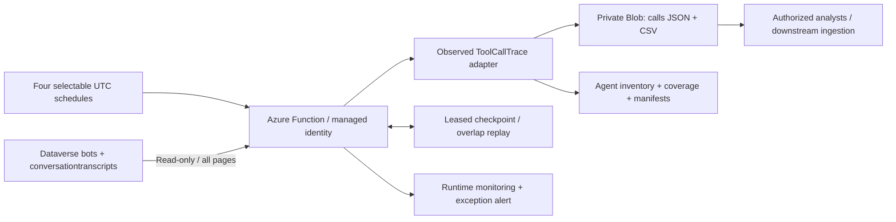

# Environment-wide conversation-to-query observability

## Outcome

An authorized operations team can trace **conversation -> observed tool call -> submitted
query -> result/error**, across agents in one Copilot Studio environment, from centralized
private JSON and spreadsheet-friendly CSV reports.

The solution preserves conversation/turn IDs, user ID, agent identity, time, tool name and ID,
query, duration, status, result summary, user prompt and agent reply. It additionally exposes
missing query evidence, partial calls, error codes, observed HTTP status and correlation quality.

## Recommendation

Deploy one Azure Functions Flex Consumption collector per environment, with managed identity,
private-access Blob containers and weekly collection as the initial setting.
Flex avoids a continuously billed Premium instance for weekly work and supports checkpointed
longer executions. Confirm regional Flex capacity, ZRS availability and actual cost before deployment.
GitHub hosts reusable code and synthetic tests only, never collected business data.

| Mode | UTC trigger | Appropriate use |
|---|---|---|
| Monthly | First day, 02:00 | Periodic reporting only after source retention is extended to at least 40 days |
| Weekly (default) | Monday, 02:00 | Operational review and recurring troubleshooting |
| Daily | Every day, 02:00 | Faster investigation and trend analysis |
| Near-live | Every five minutes | Fastest implemented transcript polling, **not real-time capture** |

Collection cadence is not data freshness. Dataverse normally saves transcripts after
30 minutes of conversation inactivity. Long-running conversations remain unavailable until saved.
For genuine lower-latency diagnostics, evaluate native environment-level Application Insights
telemetry separately. That feature is currently preview, managed-environment-only, and does not
guarantee every downstream SQL/DAX query or HTTP status.

## Architecture

The inventory includes accessible agents with no transcript activity. One paged environment-wide
transcript scan is more efficient than querying once per agent. Transcript calls are mapped to
inventory IDs; unmatched/deleted agents remain visible, rather than being dropped.

## Reliability and interpretation

- Fixed half-open `modifiedon` windows, paginated reads, bounded retry/backoff and timeouts.
- Renewable storage lease prevents concurrent checkpoint writers for an environment.
- Completed output manifests precede checkpoint updates; failed windows replay on the next run.
- A 48-hour overlap reprocesses late changes. This is **at-least-once**, not exactly-once export.
  Readers must use the latest transcript snapshot, as documented in the runbook.
- Completed, failed, suspended and pending tool attempts are distinguished.
- Missing query or HTTP code remains explicitly unavailable; the solution does not infer a 500
  from a failed tool or replace `N/A` with a fabricated HTTP code.
- Tool pairing uses tool-call IDs. Prompt/reply attribution is temporal within user-turn boundaries;
  concurrent/interleaved turns require stronger source correlation before claiming causality.
- Per-slice inventory, coverage and checksums enable inspection, not proof of regulatory completeness.

## Boundaries and acceptance

This is an enterprise-oriented reference implementation, **not yet tenant-validated or production-certified**.
The `ToolCallTrace` adapter comes from an observed working integration, not a guaranteed documented
Copilot transcript event contract. Missing/changed payloads and recording policy must be validated.
No historical query can be recovered when the platform or managed MCP never exposes it.
For custom MCPs, propagate conversation, tool-call, request and downstream query IDs into the server
logs for stronger end-to-end evidence. Managed MCPs require vendor-supported telemetry.

Before production signoff, prove successful, failed, `N/A`, consent and parallel-call scenarios in the
**published channel**, not only the test pane. Confirm agent inventory against admin inventory,
verify actual source retention and access scope, replay a failed window, test alerts and assign an owner.
Agree data classification, retention, access reviews, expected volumes and acceptable lag.

No Azure resources are deployed by repository creation or CI. Deployment requires client approval.
